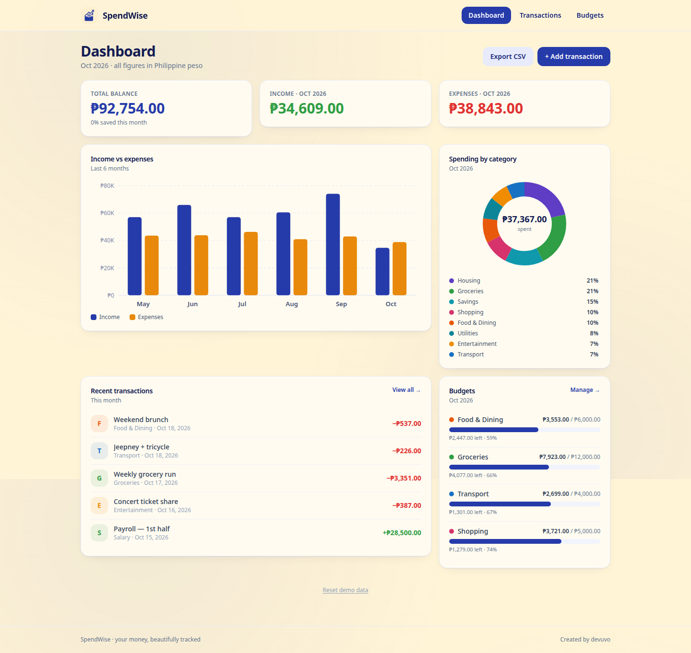

# SpendWise

[](LICENSE)
[](https://nextjs.org)
[](https://www.typescriptlang.org)


*Created by devuvo*

A personal finance dashboard. Track income and expenses, set monthly budgets per category, and see where your money goes — with a bento-grid dashboard, hand-rolled SVG charts, and Philippine peso formatting. Fully self-contained: everything is stored in your browser's localStorage. No backend, no accounts, no tracking.




## Design

- **Style:** Bento grid — the dashboard is a set of cards in mixed sizes, clean and scannable
- **Palette:** Nordic Indigo `#263BAA` + Vanilla Mist `#FFF4D6` — a deliberate light theme

## Features

- **Dashboard bento:** total balance, this month's income / expenses, savings rate, 6-month income-vs-expenses bar chart, spending-by-category donut, recent transactions, budget progress
- **Transactions:** add / edit / delete (with confirm), text search, filter by category and type, sort by date or amount, CSV export
- **Budgets:** monthly limit per category with progress bars (indigo → amber → red), edit / delete
- **Charts:** 100% hand-rolled SVG — no chart library
- **Demo data:** realistic seeded dataset (211 transactions across 6 months) on first run; "Reset demo data" restores it any time
- **Responsive:** bento stacks to a single column on mobile

## Run it

```bash
npm install
npm run dev
```

Open http://localhost:3000. Production build: `npm run build && npm start`. Deploys cleanly to Vercel.

## Files

```
app/
  page.tsx               # dashboard bento grid
  transactions/page.tsx  # search / filter / sort / CRUD
  budgets/page.tsx       # monthly budgets with progress
components/
  BentoCard.tsx  BarChart.tsx  DonutChart.tsx
  BudgetBar.tsx  TransactionForm.tsx  Navbar.tsx
lib/
  types.ts   store.ts    # context + useReducer + localStorage + seed data
  format.ts  # ₱ formatting (Intl en-PH), date helpers
  csv.ts     # CSV export
```

## Limitations

- Data lives in the browser's localStorage — clearing site data erases it. Export CSV regularly for safekeeping.
- Single-user by design; no sync across devices.
- Demo data is illustrative, not financial advice.

## License

devuvo Community License v1.0 — see [LICENSE](LICENSE). Free for personal, educational, and non-commercial use with visible credit ("Created by devuvo" + link to https://www.devuvo.com). Commercial use requires prior written approval at admin@devuvo.com.
